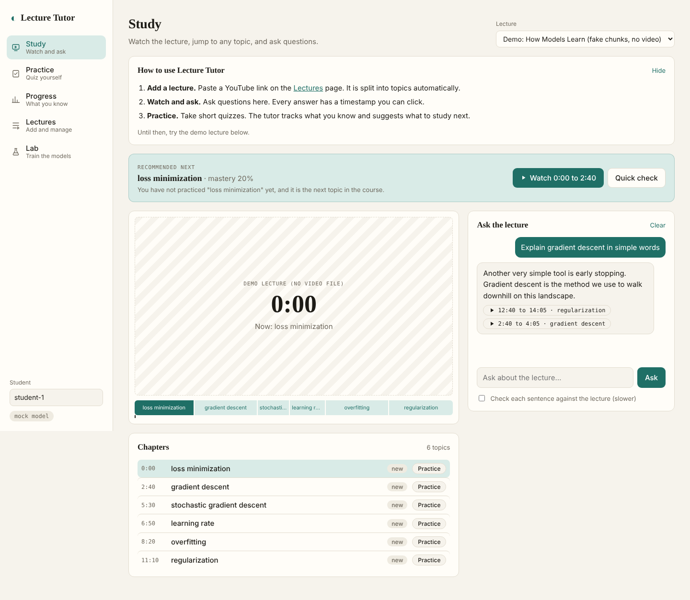
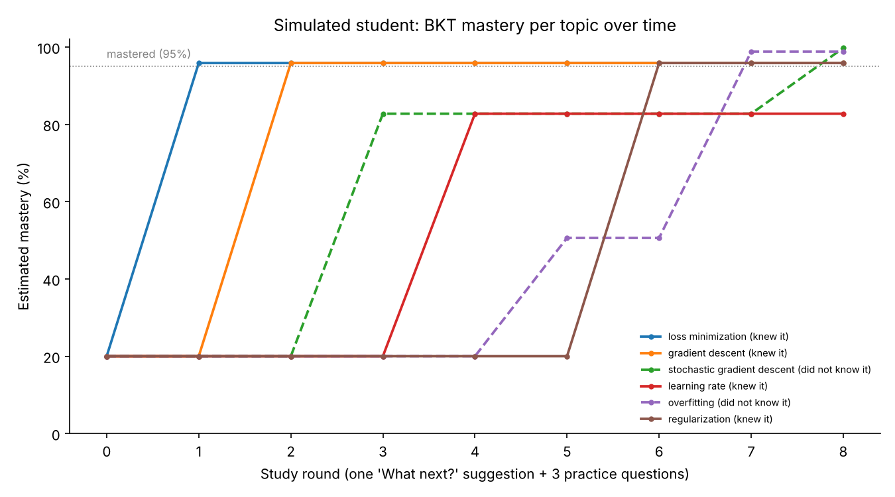
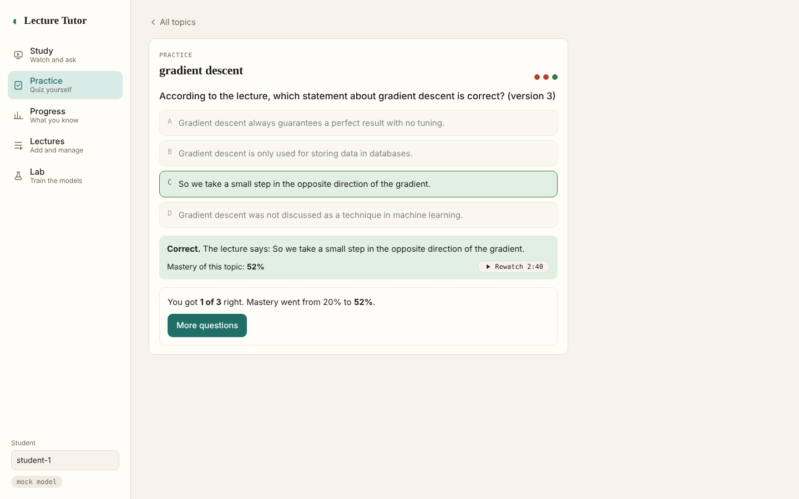
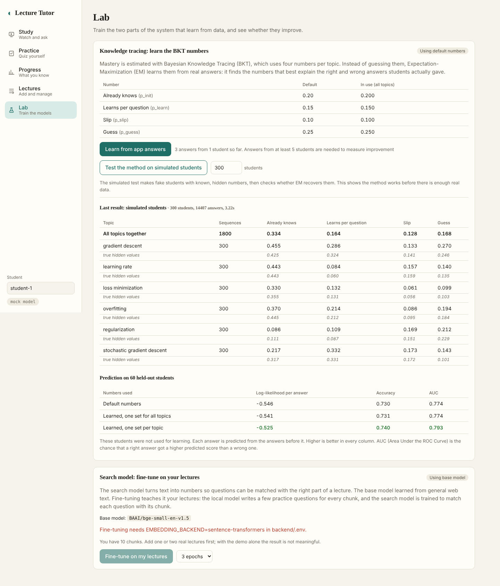
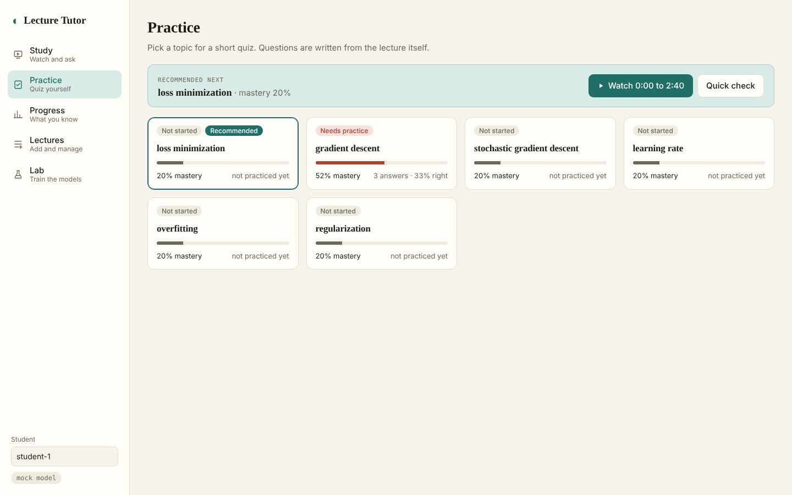
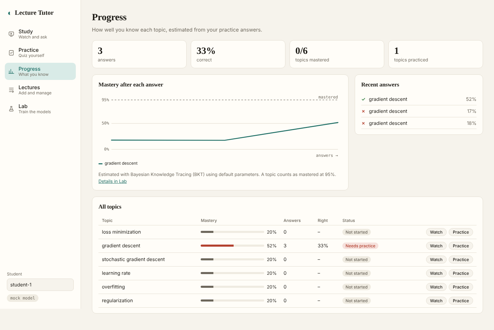
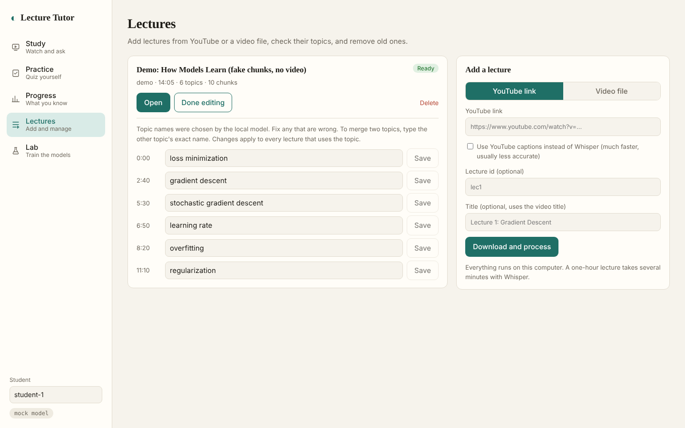

# Implementation by Role

This document explains what each team role built, how it works, and how to demonstrate it. Each section can be shown on its own.

The roles share three agreements, described in `docs/CONTRACT.md`: the chunk format, the endpoints, and a single function for calling the language model.

**What is trained in this project.** Two parts learn from data: the search model is fine-tuned on the course's lectures (Role A), and the four BKT numbers are learned from student answers with Expectation-Maximization (Role B). Whisper, Qwen and Tesseract are used as pretrained models without changes.

**Testing status.** There are 58 automated tests, and all of them pass. The tests replace Whisper, Qwen and YouTube with fake versions. All three have also been run for real on a Mac with a YouTube lecture. The Windows setup is covered by tests that simulate Windows, but it has not yet been run on a real Windows computer.

---

## Role A: Lecture RAG (Retrieval-Augmented Generation)

**Goal:** turn a lecture video into small, searchable pieces with timestamps, and answer questions using only those pieces.

### What was built

| Step | What it does | File |
|---|---|---|
| 0. Download | Downloads a YouTube lecture at 720p with yt-dlp. Can also use YouTube's own captions instead of Whisper | `app/rag/youtube.py` |
| 1. Transcribe | Whisper turns speech into text segments with start and end times. Uses mlx-whisper on Apple-silicon Macs and faster-whisper elsewhere, both fully local | `app/rag/transcribe.py` |
| 2. Read slides | Samples one small grayscale frame per second and marks a slide change when enough pixels change. Grabs a full-size frame after each change and reads it with Tesseract OCR (Optical Character Recognition). Slides with nearly the same text are merged | `app/rag/slides.py` |
| 3. Chunk | Joins transcript segments into chunks. A new chunk starts at a slide change (if the current chunk is at least 20 seconds long) or when a chunk would pass 90 seconds | `app/rag/chunker.py` |
| 4. Index | Stores every chunk twice: as a vector (a list of numbers that captures meaning, from the BAAI/bge-small-en-v1.5 model) in the Chroma database, and as keywords in a BM25 index | `app/rag/embed.py`, `app/rag/index.py` |
| 5. Search | Hybrid search: runs vector search and keyword search, then combines the two rankings with Reciprocal Rank Fusion (RRF) | `app/rag/index.py` |
| 6. Answer | Sends the question and the top 4 chunks (as text) to Qwen. Qwen must answer only from them and cite each sentence like `[2]`. The citation numbers become clickable timestamps | `app/rag/answer.py` |
| Pipeline | Runs all steps, caches each result, and reports status to the app | `app/rag/ingest.py` |

### Design decisions and reasons

- **Hybrid search instead of vector search only.** Vector search understands meaning ("memorizing training data" matches "overfitting"). Keyword search catches exact terms, symbols and names that vector search can miss ("L2", "lambda", "Adam"). RRF combines the two rankings without tuning any weights.
- **Slide text is indexed with the spoken text.** Slide titles are short and precise, so they make search better and give strong hints for topic names.
- **Pixel-change slide detection instead of ffmpeg's built-in scene detection.** In testing, ffmpeg's scene score for a white slide changing to another white slide with different text was about 0.03. The usual threshold of 0.3 missed it completely. Counting the share of pixels that changed (1% by default) detects these changes. False alarms are removed afterwards when the OCR text turns out to be the same.
- **Singular and plural forms match.** Keyword search uses light stemming ("lists" and "list" become the same word). If the model still says "not covered" but the question names one of the course's topics, the question is asked again with only that topic's chunks before falling back to an outside model.
- **Refusals are detected even with a citation.** Small models sometimes write "The lecture does not cover this [1]". A short reply where the lecture or sources are said not to contain the answer is treated as "not covered", its timestamps are removed, and the question goes to the outside-lecture model if one is set up. The evaluation turns this model off, so the accuracy numbers measure only the lecture answers.
- **Citations are cleaned up.** Small models write citations in different styles ("[Source 2]", "(Source 2)", "[1][2]"), so all of these are converted to `[n]` before the answer is parsed.
- **YouTube captions are parsed carefully.** YouTube's automatic captions "roll": each caption repeats the previous line. The parser keeps only the new words, so the transcript is not doubled.

### How to demonstrate

```
python -m app.rag.ingest --url "https://www.youtube.com/watch?v=VIDEO_ID" --id lec1
python -m eval.run_eval eval/questions_demo.json
```

The first command shows each pipeline step as it runs. The second prints a table comparing vector-only, keyword-only and hybrid search. In the app, ask a question and click a timestamp button: the video jumps to that moment.



### Training: fine-tuning the search model

The base search model (BAAI/bge-small-en-v1.5) learned from general web text. Lecture speech is informal and full of course-specific terms, so the model is fine-tuned on the course's own lectures. No manual labeling is needed.

| Step | What happens | File |
|---|---|---|
| 1. Make training data | Qwen writes 3 student-style search questions for every chunk. Each (question, chunk) pair is one training example. Results are cached, so only new chunks call the model | `app/rag/finetune.py` (`generate_queries`) |
| 2. Hold out | 15% of chunks, and all their questions, are kept out of training and used only for checking | `finetune()` |
| 3. Train | Contrastive learning with in-batch negatives (Multiple Negatives Ranking loss). In a batch of 16 pairs, each question must score its own chunk higher than the other 15 chunks. A batch never contains the same chunk twice, because that chunk would wrongly count as a negative. Optimizer: AdamW, learning rate 2e-5 with warmup, 3 epochs. Runs on the Mac GPU (graphics processor) through MPS (Metal Performance Shaders) when available | `finetune()` |
| 4. Check | Hit@1, Hit@3 and MRR (Mean Reciprocal Rank) on the held-out questions, before training and after every epoch. The best epoch is saved | `retrieval_scores()` |
| 5. Use | The Lab page (or `--use`) switches the app to the fine-tuned model and rebuilds the search index | `app/rag/embed.py` |

The training loop is written directly in PyTorch instead of using the library's trainer, because that trainer's interface changes between versions.

For the report, compare the base and fine-tuned models on your own hand-written test questions, which were never used in training:

```
python -m app.rag.finetune --epochs 3
python -m eval.run_eval eval/questions_lectures.json --embedding-models BAAI/bge-small-en-v1.5 finetuned
```

### Tests

`tests/test_ingest.py` (full video-to-chunks pipeline on a generated 3-slide video), `tests/test_youtube.py` (caption parsing, link formats, YouTube pipeline with a fake downloader), the chunker and search tests in `tests/test_tutor.py` and `tests/test_api.py`, and `tests/test_lab.py`, which runs a real fine-tuning job end to end on a tiny randomly initialized model.

---

## Role B: Tutor Engine

**Goal:** organize the lecture into topics, generate practice questions, estimate what the student knows, and decide what they should study next.

### What was built

| Part | What it does | File |
|---|---|---|
| Topic labeling | Qwen names each chunk with a short topic (1 to 4 words). Chunks are sent in batches of 20, slide titles are given as hints, and names already used are passed forward so the same topic keeps the same name | `app/tutor/concepts.py` |
| Topic review | The team can rename a bad topic, or merge two topics, from the app. Student scores and cached questions are updated to match | `app/store.py` (`rename_concept`) |
| Quiz generation | Qwen writes 4-option questions from one topic's chunks, as JSON. Each question is checked (exactly 4 different options, one valid answer, a source chunk), retried with the error message if broken, shuffled, and cached | `app/tutor/quiz.py` |
| Mastery tracking | Bayesian Knowledge Tracing (BKT) keeps one probability per student per topic and updates it after every answer | `app/tutor/bkt.py` |
| What next | Picks the unmastered topic with the lowest mastery (ties go to the earlier topic in the course) and returns the video segments that teach it | `app/tutor/recommend.py` |
| Outside-lecture answers | When the lecture does not cover a question, a chain of outside models (for example Gemini, then Groq, then the local model) answers from general knowledge. If one reaches its free limit (HTTP 429) or fails, the next one is tried, and the failed one is skipped for a cooldown (the service's Retry-After time, or 60 seconds) so later questions do not wait on it. The chat shows which model answered. The reply is labeled "[It was not covered in this lecture, but this is the answer to your question]", has no timestamps, and is never sent through the trust layer. Only the question, the last 6 chat messages and the course's topic names are sent | `app/fallback.py`, `app/rag/answer.py` |
| Trust layer | Splits an answer into sentences and asks Qwen whether each one is supported by the cited lecture text | `app/trust.py` |

### How BKT works (simple version)

Each topic has four numbers:

| Parameter | Value | Meaning |
|---|---|---|
| p_init | 0.20 | Chance the student already knows the topic before practicing |
| p_learn | 0.15 | Chance they learn it from one practice question |
| p_slip | 0.10 | Chance they answer wrong even though they know it |
| p_guess | 0.25 | Chance they guess right without knowing it (1 in 4 options) |

These are the starting values. They can be learned from data instead (see "Training" below).

After a correct answer, Bayes' rule asks: "How likely is it that they know the topic, given that they answered correctly?" A correct answer could be a guess, so mastery rises but not to 100%. After a wrong answer, mastery drops, but not to zero, because it could be a slip. Then the chance that they learned from this attempt (p_learn) is added. A topic counts as mastered at 95%. With these values, about 3 correct answers in a row from the start reach mastery.

### Design decisions and reasons

- **Topics and questions are about concepts, not examples.** Lecturers often explain an idea with a story (for example, predicting a person's music taste). The topic prompt gets the lecture title and is told to name the concept an example teaches, never the example itself. The quiz prompt is told never to ask about story details, so a student who understands the concept but forgot the story can still answer. "Find topics again" on the Lectures page reruns labeling for a lecture without transcribing it again.
- **Answers are shuffled after generation.** Small models tend to put the correct answer in the first position. Without shuffling, a student could score well just by always picking A.
- **The correct answer never goes to the browser.** The browser only gets question IDs and options. The server checks the answer.
- **Validation is forgiving where it is safe.** Small models such as Qwen 3B often return "A) ..." prefixes, the answer as a letter or as text, or a list instead of a dictionary. These are converted. Anything it cannot fix (for example 3 options) triggers a retry.
- **Questions are cached per topic.** This saves time on a local model, and the same question can be checked later by its ID. A student is given questions they have not answered yet first.
- **Practice is opt-in.** The app never forces a quiz. "What next" offers a 2-question quick check after the video segment.

### How to demonstrate

```
python -m eval.mock_student --rounds 8
```

This simulates a student who secretly knows some topics and not others. The table and chart show "What next" sending them to unpracticed and weak topics, and mastery rising as they practice. The chart is saved to `eval/results/mock_student.png`.



In the app: the **Recommended next** banner appears on the Study and Practice pages. Press **Quick check**, answer the questions, and watch the topic's mastery change.



### Training: learning the BKT numbers with Expectation-Maximization

BKT is a Hidden Markov Model (HMM): the hidden state is "knows the topic" or "does not know it", and the only thing we see is right or wrong answers. Expectation-Maximization (EM) learns the four numbers that best explain the answers students actually gave.

| Step | What happens | File |
|---|---|---|
| Data | One sequence per student per topic: their right and wrong answers in order. Every answer in the app is already saved with its topic and result | `app/tutor/bkt_fit.py` (`sequences_from_app`) |
| E-step | With the current numbers, the forward-backward algorithm works out how likely the student was to know the topic at each answer. Written in NumPy and vectorized over all sequences at once, so it takes seconds | `_forward_backward()` |
| M-step | Re-estimates each number from those probabilities. For example, p_guess = expected right answers while not knowing / expected answers while not knowing | `_m_step()` |
| Restarts and limits | EM is run from 5 starting points and the best result is kept. Guess and slip are limited to 0.4 so the model cannot "swap" its two states, which would fit the data but mean nothing | `em_fit()` |
| Per topic | Topics with at least 20 sequences get their own numbers; others use one shared set | `fit_by_topic()` |
| Check | Students are split 80/20. Numbers are learned on 80% and tested on the other 20%, predicting each answer from the answers before it. Measures: log-likelihood per answer, accuracy and AUC (Area Under the ROC Curve), compared with the default numbers | `fit_and_evaluate()` |
| Use | "Use these numbers" saves them and recalculates every student's mastery from their answer history | `apply_last_fit()`, `replay_all_students()` |

**Checking the method on simulated students.** Real answer data takes time to collect, so the method is first tested on fake students generated with known "true" numbers. If EM is correct, it should recover those numbers. In one test run with 400 simulated students and 5 topics, the learned values were close to the true ones, for example p_learn 0.330 against a true 0.331 and p_slip 0.164 against 0.172. On held-out simulated students, per-topic learned numbers predicted answers better than the defaults (AUC 0.807 vs 0.793, log-likelihood per answer -0.510 vs -0.530). These are simulated results that show the method works; results on real students will differ.

```
python -m app.tutor.bkt_fit --source simulated --students 400
python -m app.tutor.bkt_fit --source app --apply
```



### Tests

BKT direction tests and the quiz validator test in `tests/test_tutor.py`; the full adaptive loop (next, quiz, answer, mastery up, next topic changes) and topic merging in `tests/test_api.py`; JSON retry in `tests/test_llm.py`; and `tests/test_bkt_fit.py`, which checks that EM recovers known numbers within 0.06, beats the defaults in log-likelihood, and that learned numbers are applied and replayed correctly.

---

## Role C: App and Quality

**Goal:** connect everything into one app, run the local model, and measure how well it works.

### What was built

| Part | What it does | File |
|---|---|---|
| Backend API | FastAPI server with the agreed endpoints (`/ask`, `/quiz`, `/next`) plus answer checking, topics, lecture upload, YouTube links, video streaming and progress | `app/main.py` |
| Local model | All model calls go through `ask_llm()`. It uses Ollama's own API so the context window can be raised to 8192 tokens (Ollama's default is smaller and silently cuts long prompts). It also removes the `<think>` blocks that some Qwen models add | `app/llm.py` |
| Offline mode | A fake model (`LLM_PROVIDER=mock`) gives correctly shaped replies, so the interface and tests work without Ollama | `app/llm_mock.py` |
| Web app | React app with a sidebar and five pages. **Study:** video, chapter list and chat. **Practice:** topic cards that open a quiz. **Progress:** stats, mastery chart and a table of all topics. **Lectures:** library, adding lectures from YouTube or a file, editing topic names, deleting. **Lab:** runs both training jobs and shows their results. The "recommended next" topic loads automatically and updates after every answer | `frontend/src/pages/`, `frontend/src/components/` |
| Cross-platform | `install.py` and `start.py` set up and run the app the same way on macOS and Windows. `app/platform_tools.py` finds ffmpeg and Tesseract on PATH or in their usual install folders (Homebrew, Program Files, winget), decodes their output as UTF-8 (the Windows default encoding would crash on special characters), and picks the speech-to-text engine (mlx-whisper on Apple-silicon Macs, faster-whisper elsewhere) | `install.py`, `start.py`, `app/platform_tools.py` |
| Lab API | Starts and reports on the two training jobs. Search model training runs in the background with a progress bar | `app/main.py` (`/lab/...`), `app/jobs.py` |
| Model status | The badge in the top bar shows whether Ollama is running and whether the model is downloaded. Model errors are shown as readable messages instead of crashes | `app/main.py`, `frontend/src/App.jsx` |
| Evaluation | Measures search quality, answer accuracy, refusals, claim support, quiz reliability and speed, for one or more local models, and writes a report | `eval/run_eval.py` |
| Demo script | The simulated student session with a saved chart | `eval/mock_student.py` |

### How to demonstrate

```
python -m eval.run_eval eval/questions_lecture1.json --answers --quiz --lecture lecture1 --models qwen2.5:7b qwen3.5:9b
```

This prints the results and writes `eval/results/report.md` with tables ready for the final report.

### Model comparison: Qwen 2.5 7B vs Qwen 3.5 9B

Run on a MacBook Pro (24 GB RAM) with the "DSA in 25 mins" lecture (71 chunks): 35 questions with the time range of the answer, plus 4 questions the lecture does not cover. Qwen 3.5 ran with thinking turned off.

| | qwen2.5:7b | qwen3.5:9b |
|---|---|---|
| Answer cites the right part of the lecture (35) | 35/35 | 35/35 |
| Wrongly said "not covered" (35) | 0/35 | 0/35 |
| Correctly said "not covered" (4 off-topic) | 4/4 | 4/4 |
| Median time per answer | 2.05 s | 2.67 s |
| Average answer length | 226 characters | 368 characters |
| Quiz JSON valid on the first try | 95% | 100% |
| Median time to write 3 quiz questions | 9.9 s | 9.8 s |

Search, same for both models: Hit@1 0.69 (vector only), 0.69 (keyword only), 0.74 (hybrid); Hit@4 0.97, 0.97 and 1.00.

The two models were equal on accuracy. Qwen 3.5 9B was chosen as the default because its answers are more detailed and its JSON output (quizzes, topic labels) was more reliable, at the cost of about 0.6 seconds per answer. With 39 questions the differences are small, so this is a reasonable choice, not a strong measured win. Qwen 3.5's off-topic score was first reported as 3/4 because its refusal was a long reply with citations; the refusal detector was fixed and both models' saved answers were re-scored.

In the app: walk through the full student journey. Add a lecture on the Lectures page, ask a question on the Study page, click the timestamp, follow the recommended topic, practice, and open Progress. Finish on the Lab page to show the two training jobs.







### Tests

`tests/test_api.py` (every endpoint through the real FastAPI app), `tests/test_lab.py` (Lab endpoints and lecture stats) and `tests/test_llm.py` (the Ollama request format, "Ollama offline" and "model not downloaded" messages).

---

## Still to do (needs your Mac and your lectures)

| Who | Task |
|---|---|
| A | Run 2 to 3 real lectures through the pipeline. Check that slide detection and chunk lengths look sensible. Fine-tune the search model and compare it with the base model on the hand-written test questions |
| B | Review the topic names Qwen gives and fix bad ones in the app. Read 10 to 20 generated questions and adjust the quiz prompt if they are too easy or unclear. Collect real answers from at least 5 people, then learn the BKT numbers from them |
| C | Write 30 to 50 test questions with time ranges for the real lectures. Extend the test questions to the other lectures, rerun the evaluation with the chosen model, and put `report.md` and the charts in the final report |
